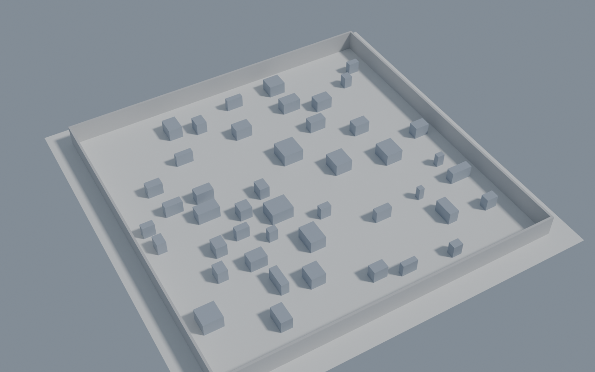
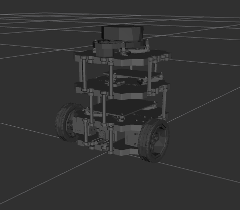

# TurtleBot3 + Nav2 in Gazebo

A TurtleBot3 Burger in Gazebo with the ROS 2 Navigation2 stack, navigating autonomously to a
goal in an environment with obstacles. ROS 2 Humble, Gazebo Classic, C++ for our own nodes.

## Setup

### Prerequisites

- Docker, and an X server (`$DISPLAY` set) for Gazebo and RViz.
- The `supermarketbot:humble` image (ROS 2 Humble, Nav2, slam_toolbox, RViz). Check with
  `docker images`. The host doesn't need to be Ubuntu 22.04, since everything runs in the
  container.

### 1. Build the image

Adds Gazebo Classic and the TurtleBot3 packages on top of `supermarketbot:humble`, and sets
`TURTLEBOT3_MODEL=burger`:
```bash
cd ~/projects/tb3_assignment
docker build -t tb3assign:humble .
```

### 2. Start the container

```bash
xhost +local:docker
docker run -it --name tb3assign --net=host \
  -e DISPLAY=$DISPLAY -e LIBGL_ALWAYS_SOFTWARE=1 \
  -v /tmp/.X11-unix:/tmp/.X11-unix \
  -v ~/projects/tb3_assignment:/ros2_ws \
  tb3assign:humble
```
- `--net=host`: ROS 2 discovery is multicast-based, and bridged networks break it. Stop any
  other ROS container first, since both would share one ROS domain.
- `-v ~/projects/tb3_assignment:/ros2_ws`: the project is the colcon workspace, mounted at
  `/ros2_ws` (the path the build commands below use). Mounts can't be changed on an
  existing container; remove it with `docker rm -f tb3assign` and run again.
- `LIBGL_ALWAYS_SOFTWARE=1`: there is no GPU passthrough, so Gazebo and RViz render on the CPU.
- `xhost +local:docker` lets the container draw on your display. It doesn't survive a new
  login, so run it again if a window fails with `No protocol specified`.

Later sessions:
```bash
docker start -ai tb3assign       # to start the container
docker exec -it tb3assign bash   # extra shell in the running container
```

### 3. Build the package

```bash
cd /ros2_ws
source /opt/ros/humble/setup.bash
colcon build --packages-select tb3_bot
```
(`--packages-select`, not `--package-select`.) Launch files and configs are installed
copies, so rebuild after editing them.

### Every shell

Every new shell (each `docker exec`, and any shell open during a build) needs both lines,
ROS first and then the workspace, before any `ros2` command:
```bash
source /opt/ros/humble/setup.bash
source /ros2_ws/install/setup.bash
```
Without the second line ROS doesn't know about `tb3_bot`: `ros2 pkg prefix tb3_bot` prints
`Package 'tb3_bot' not found`. After a rebuild, shells that are already open pick up the
changes only if they source it again.

## World: SC7a clutter field

The robot runs in `src/tb3_bot/models/SC7a_clutter_field_low.sdf`. It is an SDF **world**
(the arena, with no robot in it), not a URDF. The robot's own description comes from the
TurtleBot3 packages.



*Overview render of the world (`src/tb3_bot/models/render_overview.png`): the walled arena
with the 45 blocks.*

### Source

- Collection: [`mertgulerx/world-collection`](https://github.com/mertgulerx/world-collection),
  42 Gazebo worlds for testing robot exploration, navigation and SLAM, built for the
  exploration benchmark of the author's `frontier_exploration_ros2`.
- Announcement:
  [42 Gazebo Harmonic simulation worlds for navigation, exploration and SLAM workflows](https://discourse.openrobotics.org/t/42-gazebo-harmonic-simulation-worlds-for-navigation-exploration-and-slam-workflows/58934)
  (Open Robotics Discourse).
- Licence: Apache-2.0, as stated in the collection's README. The collection also has a
  `CITATION.cff` file with citation details.
- In the collection's naming, **SC** worlds are the single-challenge ones, each targeting one
  difficulty. SC7a is the "clutter field": blocks that hide each other, with SC7b the denser
  version of the same field.

### What the world contains

| Property | Value |
|---|---|
| World name | `sc7a_clutter_field_low` |
| Arena | 30 × 30 m floor, four 2 m tall outer walls |
| Obstacles | 45 static blocks, 1.2 m tall, 0.5–2.0 m wide |
| Minimum gap | 1.0 m between blocks, and 1.0 m between a block and a wall |
| Spawn area | nothing within 1.5 m of the origin, so the robot can start at (0, 0) |
| Geometry | plain boxes only (50 collision elements: ground, 4 walls, 45 blocks), no meshes |
| Generation | `worldgen` 1.0.1, seed 7100, from the file's own header |
| Physics | ODE, 0.01 s step, 200 Hz |

World and map coordinates coincide, because the spawn point is the world's origin.

### Gazebo version

The file targets **Gazebo Harmonic** (SDF 1.9, `gz-sim-*-system` plugins). This project uses
**Gazebo Classic** (ROS 2 Humble with `gazebo_ros`), which is a different simulator. The file
is therefore kept unchanged here as the original, and a Classic-compatible copy is made
when the world is first launched (see `PROCESS.md`). Any modified copy will say so, as the
Apache-2.0 licence requires.

## Robot model: TurtleBot3 Burger



*The Burger in RViz: two drive wheels, the stacked plates and the lidar on top
(`src/tb3_bot/models/robot_model.png`).*

The robot description is the stock one from the `turtlebot3_description` package (installed
in the image), read at launch time rather than copied into this repository. The
`TURTLEBOT3_MODEL` environment variable picks the model, and the Dockerfile sets it to `burger`.

`launch/rsp.launch.py` publishes the robot's TF tree from that URDF with no simulator running, so
the model can be checked in RViz first.

### View it in RViz

Rebuild first if you edited a launch file (launch files are installed copies):
```bash
cd /ros2_ws
colcon build --packages-select tb3_bot
```

Shell 1, publish the robot description and TF:
```bash
source /opt/ros/humble/setup.bash
source /ros2_ws/install/setup.bash
ros2 launch tb3_bot rsp.launch.py
```

Shell 2 (`docker exec -it tb3assign bash`), open RViz:
```bash
source /opt/ros/humble/setup.bash
source /ros2_ws/install/setup.bash
rviz2
```
In RViz: **Add → RobotModel** and set its **Description Topic** to `/robot_description`;
**Add → TF** to see the frames; choose the robot's root frame as the **Fixed Frame**.

## Gazebo: spawn the robot

`launch/gazebo.launch.py` starts Gazebo Classic with an empty world, publishes the robot's TF
(from the URDF) and spawns the TurtleBot3 at the origin from `turtlebot3_gazebo`'s `model.sdf`.
The SDF is what carries the plugins that publish `/odom` and `/scan` and drive the wheels; the
URDF has none of them. Stop the `rsp.launch.py` shell first: it publishes
the same robot, and only one of the two should run.

```bash
cd /ros2_ws
colcon build --packages-select tb3_bot
source /opt/ros/humble/setup.bash
source /ros2_ws/install/setup.bash
ros2 launch tb3_bot gazebo.launch.py gui:=false     # or gui:=true for the Gazebo window
```
`gui:=false` runs the simulation without its window, which is much lighter under software
rendering. Check what the simulation publishes from a second shell (both setup files sourced):
```bash
ros2 topic list
ros2 node list
```
